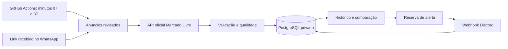

# PromoSearch — Radar Gamer

Monitor conservador de preços de notebooks gamers em Python. Execuções curtas no GitHub Actions, estado persistente em PostgreSQL privado e alertas por webhook Discord. Não exige computador ligado após a implantação.

**Estado da entrega:** repositório público, CI e conexão real do GitHub Actions ao Supabase aprovados. A conexão restrita e a chave de criptografia foram salvas em GitHub Secrets pelo proprietário. Conector oficial Mercado Livre implementado e testado com fixtures; autorização real da API e webhook ainda estão pendentes. Nenhuma oferta real foi validada nem recurso pago criado. O catálogo inicial está vazio intencionalmente.

**Progresso da implantação:** a [verificação real do banco pela nuvem](https://github.com/KaueSun/PromoSearch/actions/runs/39455732091) e o [CI Linux](https://github.com/KaueSun/PromoSearch/actions/runs/39455636648) passaram. O usuário `radar_app` acessa as dez tabelas do schema privado `radar`, sem criar tabelas, papéis ou bancos. Veja os configuradores privados de [banco](docs/CONFIGURAR-BANCO.md) e [Discord](docs/CONFIGURAR-DISCORD.md). O cron permanece desabilitado até concluir as integrações reais.

## O que mudou no MVP

O MVP original passou nos 8 testes existentes. Foram aproveitados os conceitos de comparação por configuração, histórico, controle de repetições, embeds e entrada manual. A versão 0.2 substitui SQLite de produção por PostgreSQL e separa os módulos. Também elimina alertas baseados apenas no desconto anunciado, dados fictícios em produção, CPUs genéricas e renovação de token dependente de intervenção a cada seis horas.

O histórico SQLite antigo **não é importado automaticamente**: ele pode conter dados da demonstração. Antes de qualquer migração, é preciso separar registros comprovadamente reais e revisar os SKUs.

## Arquitetura



| Pasta / módulo | Responsabilidade |
|---|---|
| `radar_gamer/domain.py` | Configuração exata, dinheiro em centavos e validação de URLs |
| `config.py` / `config/catalog.json` | Produtos revisados, vendedores aprovados e limites |
| `meli.py` / `oauth.py` | API oficial, verificação de mudanças e renovação OAuth cifrada |
| `storage.py` | Schema, histórico, bloqueio de execuções, alertas e retenção |
| `analysis.py` | Medianas, qualidade, anomalias e comparação manual |
| `discord.py` | Embeds e confirmação de entrega |
| `service.py` / `cli.py` | Execução limitada, comandos e logs sem credenciais |
| `.github/workflows/` | Testes sem segredos e monitoramento da branch principal |
| `tests/` | Dados sintéticos explicitamente isolados e contratos de banco/API |

## Serviços e custo inicial

Verificação documental em **20/10/2026**; confirme os limites no painel antes de ativar.

| Serviço | Plano gratuito / restrição | Decisão |
|---|---|---|
| GitHub Actions | Runners padrão gratuitos em repositório público; runners maiores são cobrados; armazenamento tem quota | `ubuntu-latest`, sem artifacts de produção nem caches persistentes |
| Supabase | 500 MB de banco por projeto, dois projetos gratuitos, 5 GB de egress; pode pausar por baixa atividade em sete dias | Preferido porque o proprietário já possui conta; usar Free e acompanhar consumo |
| Neon | 1 GB/projeto, 100 CU-h/mês/projeto, 5 GB de transferência pública/projeto; suspensão do compute após cinco minutos ociosos | Alternativa compatível, sem necessidade de migrar agora |
| Discord | Webhook com limites de requisição | Baixo volume e tratamento de 429 |

Não há garantia de intervalo exato ou disponibilidade contínua no plano gratuito. O GitHub pode atrasar/descartar execuções agendadas sob carga e desativa agendamentos de repositórios públicos após 60 dias sem atividade. Um job não detecta a própria ausência: acompanhe o último horário no Actions e configure notificações de falha da sua conta GitHub. Não foi criado um monitor externo.

Fontes: [GitHub cobrança](https://docs.github.com/en/billing/concepts/product-billing/github-actions), [agendamento](https://docs.github.com/en/actions/reference/workflows-and-actions/events-that-trigger-workflows#schedule), [Supabase limites](https://supabase.com/docs/guides/platform/billing-on-supabase), [pausas](https://supabase.com/docs/guides/platform/free-project-pausing), [Neon](https://neon.com/pricing).

## Fontes de preços: cobertura real

O conector disponível consulta **anúncios específicos do Mercado Livre**, mediante acesso autorizado. Ele não descobre todo o catálogo. API implementada não significa acesso aprovado: a validação final exige um token do proprietário e uma consulta real aceita pela plataforma.

Amazon, Shopee, KaBuM!, Magalu e Casas Bahia não têm conectores de coleta nesta versão. Entradas manuais são identificadas como não verificadas. Consulte [FONTES.md](docs/FONTES.md) para autenticação, limitações e próximos passos. Nenhuma página de varejo é raspada; redirecionamentos, links curtos e anúncios com variações ambíguas são recusados.

## Instalação e testes

Python 3.12 ou superior. Abra o terminal na raiz do projeto:

```powershell
python -m venv .venv
.\.venv\Scripts\Activate.ps1
python -m pip install --require-hashes -r requirements-dev.txt
python -m pytest -q
python -m ruff check radar_gamer tests
```

Em Linux, ative com `source .venv/bin/activate`. Para execução sem testes, instale `requirements.txt`. O comando `python radar.py` funciona diretamente; instalar o próprio projeto é opcional (`pip install --no-deps -e .`). Os arquivos de dependências fixam versões e hashes; atualize-os com revisão antes de aceitar sugestões do Dependabot.

Sem `TEST_DATABASE_URL`, o teste PostgreSQL é explicitamente pulado. Para executar todos, use um banco descartável PostgreSQL 16+; o teste cria/remove somente um schema com nome aleatório. O CI fornece um PostgreSQL 18 isolado, com senha fictícia. Nunca aponte testes para produção.

## Implantar no Supabase + GitHub

1. Entre no Supabase e selecione/crie um projeto **Free**, sem addons pagos. Execute o SQL de [bootstrap-supabase.sql](docs/bootstrap-supabase.sql) para criar `radar_app` e o schema privado `radar`. Defina a senha desse papel em um canal privado no painel ou com `psql` e `\password radar_app` (conexão administrativa; não exponha a senha em histórico de comandos).
2. Em **Connect**, copie o host/porta do **Session pooler**. É acessível por IPv4, evitando contratar o addon IPv4. Substitua o usuário por `radar_app.REFERENCIA_DO_PROJETO` e use a senha desse papel. A conexão usa TLS e não usa a Data API. Mantenha `radar` fora dos schemas expostos. Veja [conexões oficiais](https://supabase.com/docs/guides/database/connecting-to-postgres).
3. Configure `DATABASE_URL` privadamente no terminal e execute `python radar.py init-db`. O comando cria as tabelas, não elimina dados. A versão de schema atual é 1; versões futuras precisarão de migrações explícitas.
4. Crie uma aplicação no portal de desenvolvedores Mercado Livre e conclua o consentimento OAuth autorizado. Acesso de comprador/afiliado e escopos precisam ser aceitos pela plataforma. Não use tokens de terceiros nem presuma que qualquer conta pode consultar qualquer anúncio. Configure os seis Secrets da tabela abaixo.
5. Gere uma chave com `python radar.py keygen` **somente em um terminal privado**, salve-a no Secret e guarde uma cópia segura. A primeira troca usa o refresh token inicial; tokens seguintes ficam cifrados no banco. A chave nunca fica no banco. Não execute keygen no Actions.
6. Revise ao menos um anúncio real conforme a seção seguinte. O catálogo vazio impede ativação acidental.
7. Publique o código no repositório público **PromoSearch** após a autorização do proprietário. Crie o Environment **production**, restrinja deployments à branch principal e coloque os Secrets nesse ambiente. Não configure aprovação obrigatória a cada execução se quiser agendamento automático. Proteja a branch e revise alterações de código/workflow antes de integrá-las.
8. Execute o workflow manualmente, confira o CI, o resumo do job, o histórico no banco e a execução seguinte. Valide o primeiro alerta real quando houver evidência suficiente. Não fabrique um desconto para testar o canal.

Para a implantação assistida atual, use os scripts `docs/setup-schema.sql` e `docs/setup-access.sql` em vez de criar tabelas como proprietário `radar_app`: as tabelas pertencem ao administrador e a aplicação recebe somente CRUD. O workflow **Database check** verifica esse acesso separadamente, usando apenas `DATABASE_URL`. O agendamento do monitor fica desativado até definir a variável **de repositório** `MONITOR_ENABLED=true`, após configurar todas as credenciais e revisar anúncios reais. A execução manual continua disponível para configuração e diagnóstico.

| GitHub Secret | Conteúdo |
|---|---|
| `DATABASE_URL` | URI PostgreSQL do papel privado `radar_app` com senha percent-encoded |
| `DISCORD_WEBHOOK_URL` | Webhook do canal de texto, domínio `discord.com` |
| `MELI_CLIENT_ID` | ID da aplicação autorizada |
| `MELI_CLIENT_SECRET` | Segredo da aplicação |
| `MELI_REFRESH_TOKEN` | Refresh token inicial obtido no OAuth |
| `TOKEN_ENCRYPTION_KEY` | Chave Fernet gerada privadamente |

Os exemplos `.env.example` não são carregados automaticamente. Nunca comite arquivos `.env`, backups ou URLs de conexão. O README não solicita segredos pelo chat.

## Revisar e acompanhar notebooks

Prioridade: Nitro, TUF, LOQ, G15 e configurações relevantes com RTX 2050/3050/4050/4060. Marcas e GPUs não são limitadas por uma lista artificial: adicione outros modelos exatos quando revisados.

1. Cadastre a ficha exata em `config/catalog.json`, seguindo a estrutura de `config/product.example.json`. O exemplo é fictício e não é carregado pela aplicação. Informe CPU completa, GPU, RAM, SSD, código do fabricante e, quando conhecidos, tela, VRAM e TGP. Use o mesmo SKU apenas para configurações realmente equivalentes. Não complete campos por adivinhação.
2. Com os Secrets configurados no terminal privado, execute `python radar.py inspect URL_COMPLETA_DO_ANUNCIO`. A saída mostra atributos, vendedor e assinatura SHA-256. Confira todos os atributos com a ficha do fabricante e o anúncio. Essa revisão humana é obrigatória; a assinatura detecta mudanças futuras, mas **não prova que uma ficha cadastrada incorretamente esteja certa**.
3. Inclua o ID real do vendedor em `trusted_meli_sellers` após revisar sua identidade. O conector também exige reputação verde atual. IDs aprovados e configurações são dados públicos; credenciais não são.
4. Cadastre com `python radar.py watch URL --sku CHAVE_EXATA --signature ASSINATURA_REVISADA`. Ou use **Actions → Radar Gamer → Run workflow → watch**, colando URL, SKU e assinatura. O cadastro vai para o banco, sem acesso ao WhatsApp.
5. `python radar.py check` coleta e grava histórico sem enviar; `python radar.py check --send` envia candidatos qualificados. `unwatch URL` desativa um anúncio. O workflow permite `unwatch` também.

O conector valida a identidade MLB, moeda BRL, estado de disponibilidade e assinatura dos metadados. Mudanças de atributos, vendedor, título ou condição interrompem o anúncio até nova revisão. Ele não consulta frete personalizado: **frete permanece desconhecido** mesmo que a API indique um selo de frete grátis.

## Como as promoções são selecionadas

- 20% abaixo de uma mediana histórica diária de 7, 30 ou 90 dias, com ao menos sete dias observados na janela; cada referência informa a cobertura real, não promete 90 dias completos quando só há sete.
- 12% abaixo da mediana de pelo menos dois **outros vendedores independentes**, com configuração, condição e total com frete equivalentes e observações recentes.
- 10% abaixo da mediana diária recente de sete dias, com pelo menos três dias observados.

As condições são alternativas. Preços abaixo de R$ 1.200 ou quedas de 60% ou mais contra uma referência disponível são separados para revisão e não entram nas referências confiáveis. Esses pisos são filtros configuráveis de anomalia, não estimativas de valor de mercado. Produtos novos são o padrão; usados/recondicionados ficam isolados e só podem alertar com `allow_non_new=true`, identificados no embed.

Frete conhecido e desconhecido nunca se misturam. Sem frete, histórico compara **somente preço do produto**, com aviso explícito. A comparação entre vendedores por total está implementada e testada, mas não se ativa no conector inicial enquanto não existir uma cotação legítima de frete. Preço anunciado original, cupom não confirmado e cashback não viram desconto calculado.

Sem base suficiente, apenas acumulamos histórico. Não há promessa de alerta imediato no primeiro dia. Os parâmetros ficam em `config/catalog.json` e não exigem alteração de código.

## Evitar spam e entregas incertas

O mesmo anúncio só alerta novamente se cair pelo menos 5% desde o último envio, respeitando uma hora de intervalo e a mesma base de frete. Há limite de cinco alertas por execução. Um bloqueio no banco e a concorrência do workflow impedem execução simultânea.

O alerta é reservado no banco antes do POST. O Discord confirma com `wait=true`; o ID é registrado após a confirmação. Em timeout ou falha ambígua, o estado vira `uncertain` e bloqueia reenvio automático. Se o processo morrer durante o envio, `dispatching` também bloqueia. Isso evita duplicação, mas pode exigir conciliação manual; webhook não oferece garantia de entrega exatamente uma vez. Veja [operação](docs/OPERACAO.md).

## Comparar links recebidos no WhatsApp

Para Mercado Livre, use o cadastro acima; o monitor consulta a API após a revisão. Para outras lojas, prepare um arquivo privado:

```json
[{"sku":"CHAVE_REAL_REVISADA","url":"https://www.amazon.com.br/dp/ID_REAL",
  "price":3999.90,"shipping":null,"condition":"new"}]
```

O JSON acima ilustra o formato, não uma oferta. Execute `python radar.py manual private/ofertas.json`. A aplicação guarda o cadastro separadamente e compara provisoriamente o preço digitado com medianas históricas disponíveis da mesma configuração e condição. A comparação informa base/quantidade de dias e devolve `null` para desconto quando faltam dados. Ela não consulta o link, não envia alerta e não acrescenta o preço digitado ao histórico verificado. Nenhuma conta, mensagem, QR code ou sessão do WhatsApp é acessada.

## Operação e próximos passos

`python radar.py status` informa última execução, contadores, entregas pendentes e tamanho do banco. `cleanup` remove observações e cadastros manuais antigos; a limpeza também roda ao fim de cada verificação. A retenção padrão é 100 dias, com uma observação por anúncio a cada meia hora. Registros de alertas enviados/incertos são preservados para impedir spam após a limpeza.

Logs públicos contêm eventos e contadores; dados privados e respostas brutas de API não viram artifacts. Falha parcial termina o job com erro mesmo quando outras lojas/anúncios funcionam. Para manutenção, backup privado e diagnóstico, consulte [OPERACAO.md](docs/OPERACAO.md).

Próximos marcos: aprovar as contas e a primeira consulta real; confirmar a execução agendada no Supabase; habilitar cotação de frete autorizada; expandir fontes somente com acesso permitido; adicionar descoberta de anúncios quando o escopo da API permitir. Monetização exige verificar termos de afiliados, armazenamento e exibição de preços de cada fonte antes da integração.

